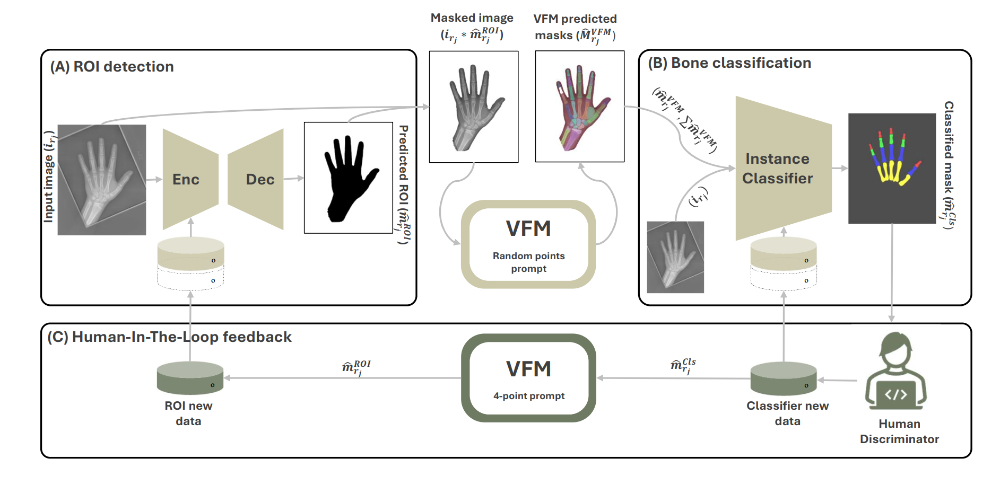

# PedVision

This is the official code repository for the paper "PedVision: Integrating human-in-the-loop with visual foundation models for age-agnostic pediatric hand bone segmentation". The image below outlines the pipeline (see the paper for more details), and we will walk you through the code for each part in the sections below.



## News
- **[Nov 2026]** The manually segmented test sets used in the paper are now available in [`datasets`](datasets): 200 RSNA Pediatric, 200 RSNA near-skeletally-mature (NSM) and 152 Digital Hand Atlas (DHA) hand X-rays, each with a ground-truth mask of 19 hand bones in 4 classes (distal, middle and proximal phalanges, and metacarpals). See [`datasets/README.md`](datasets/README.md) for details, and please [cite](#citation) the papers below if you use them.

## Table of Contents
1. [Dependencies Installation](#dependencies-installation)
2. [Testing the Pipeline](#testing-the-pipeline)
3. [Citation](#citation)
4. [License](#license)
   
> [!NOTE]
> - Open this link in a new tab to see toturial on YouTube for test part: [PedVision test](https://youtu.be/hi7YJ2_5c7U?si=YMx7D0kBZptvXszS)

## Dependencies Installation
Follow the following steps to install all dependencies!

```
conda create -n pedvision_env python=3.10.12 
conda activate pedvision_env
git clone https://github.com/mohofar/PedVision.git
cd PedVision
conda install pytorch==2.3.1 torchvision==0.18.1 torchaudio==2.3.1 pytorch-cuda=12.1 -c pytorch -c nvidia
pip install -r requirements.txt
```

Please update the PATH in `sys.path.append(r'./PedVision')
` in main.py file based on your location of the downloaded repo. 


## Testing the pipeline
To test the trained PedVision pipeline, refer to the following example using the `1512.png` image.
```
python PedVisionCode/main.py --foldering y
```
**Download Trained Weights:**
   Download and place the trained weights in the `PedVisionCode/saved_models` folder.
   | Model | Weights |
   |-------|---------|
   | VFM#1 (SAM ViT_h) | [Download](https://dl.fbaipublicfiles.com/segment_anything/sam_vit_h_4b8939.pth)|
   | ROI model (last Round) | [Download](https://drive.google.com/file/d/1K0PphrPPlv3mmlW1dIVcqhA2V8ZyVe5u/view?usp=drive_link) |
   | CLS model (last Round) | [Download](https://drive.google.com/file/d/17q_-KDSkWPPItRgj9a-knF82-ZiFXUcQ/view?usp=drive_link) |
```
python PedVisionCode/main.py --test_model y --round 11 --num_classes 5  --img_name 1512 --CLS_model_name EffiB5
```
**Note**: The pipeline will prepare the masks of all images in the test folder in the first run.

## Citation
If you use this code or the datasets (RSNA or DHA annotations), please cite:

```bibtex
@article{homayounfar2026pedvision,
  title   = {PedVision: A manual-annotation-free and age scalable segmentation pipeline for bone analysis in hand X-ray images},
  author  = {Homayounfar, Morteza and Bierma-Zeinstra, Sita M. A. and Zadpoor, Amir A. and T{\"u}mer, Nazli},
  journal = {Biomedical Signal Processing and Control},
  volume  = {112},
  pages   = {108569},
  year    = {2026},
  doi     = {10.1016/j.bspc.2025.108569}
}
```

If you use the RSNA annotations, please also cite:

```bibtex
@article{tay2025growth,
  title   = {Towards growth-accommodating deep learning-based semantic segmentation of pediatric hand phalanges},
  author  = {Tay, Edwin and Zadpoor, Amir A. and T{\"u}mer, Nazli},
  journal = {Biomedical Signal Processing and Control},
  volume  = {102},
  pages   = {107338},
  year    = {2025},
  doi     = {10.1016/j.bspc.2024.107338}
}
```

If you use the datasets, please also cite the original image sources ([Halabi et al., 2019](https://doi.org/10.1148/radiol.2018180736) for RSNA and [Gertych et al., 2007](https://doi.org/10.1016/j.compmedimag.2007.02.012) for DHA); the BibTeX entries are in [`datasets/README.md`](datasets/README.md#citation).

## License
This project is licensed under the terms of the MIT license.
